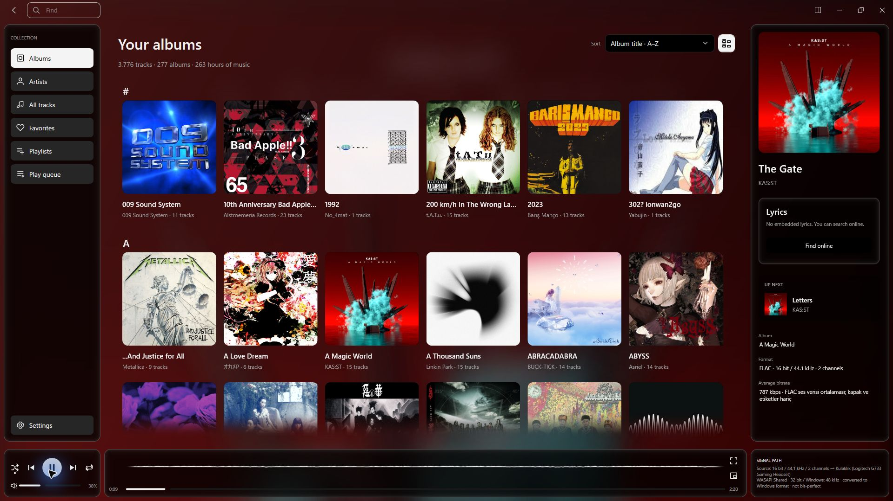
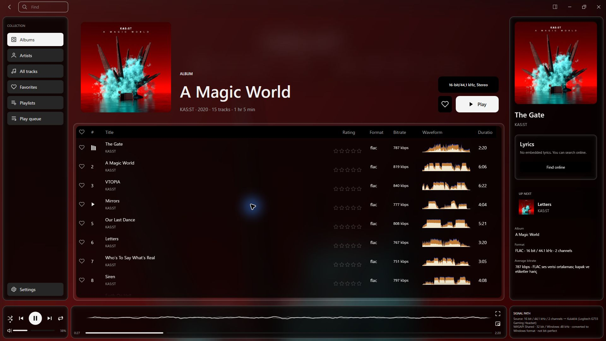
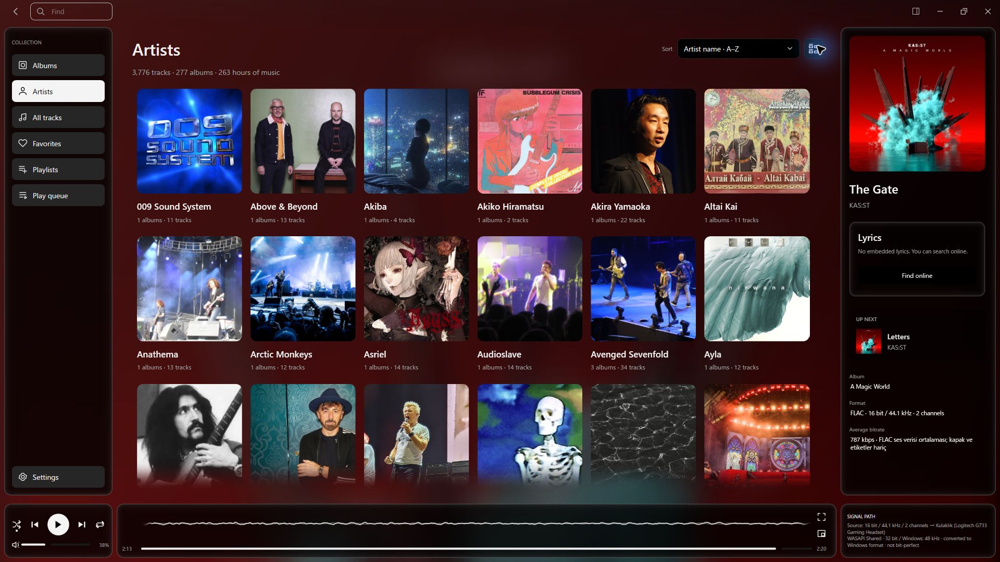
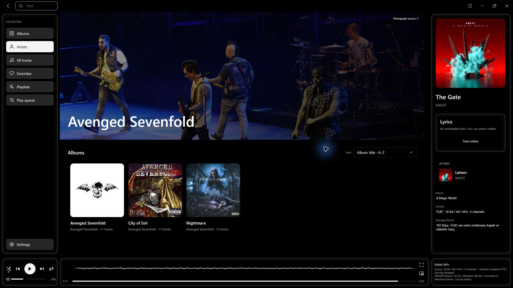
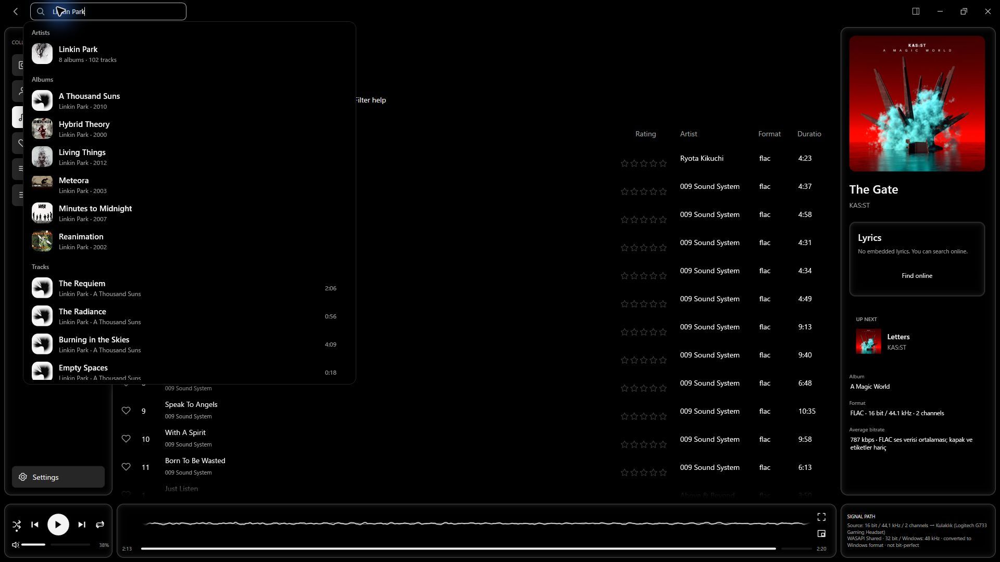
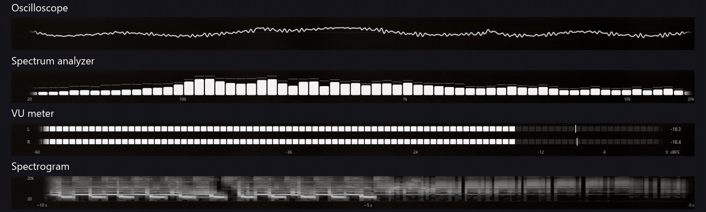
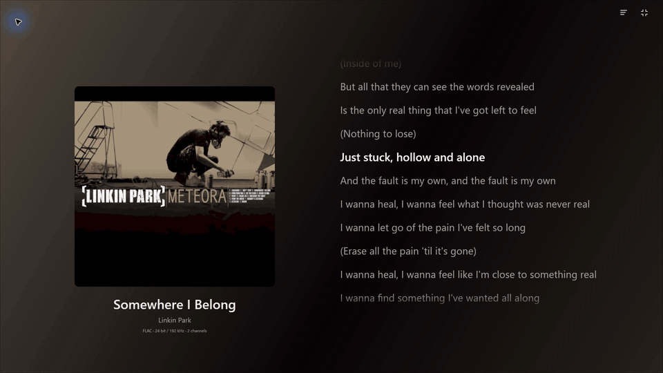
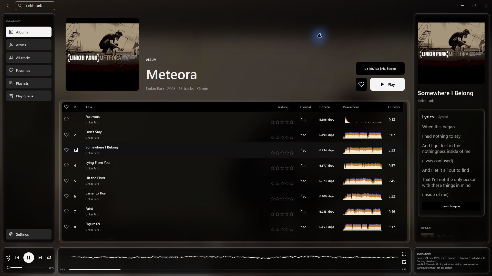
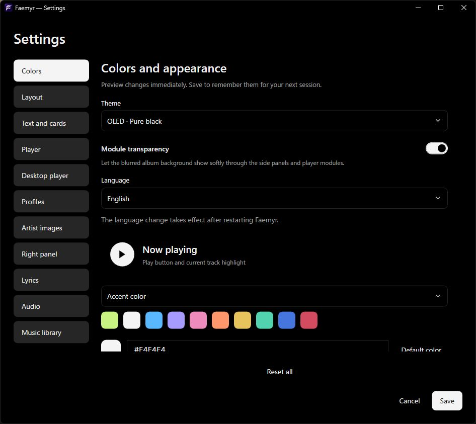

# Faemyr — Local Music Player

Faemyr is a customizable, local-first music player for Windows, combining high-resolution audio with a modern modular interface and a personal music library. Current version: **0.10.53**.

Faemyr plays the music files on your computer. Library scanning, artwork and audio visualization work locally. Optional online lyrics, artist photographs and Wikipedia summaries require an internet connection. The interface is available in English and Turkish.

## Features

- Browse albums and artists, search your collection, and manage queues, playlists and smart playlists.
- Group albums and artists by letter; multi-disc albums show separate numbered disc headings in track order.
- Artist profiles with photographs, localized Wikipedia biographies, attribution and offline caching.
- Track and album favorites, five-star ratings, and library filters.
- FLAC, ALAC, WAV, AIFF, WavPack and other supported audio formats; detailed metadata and signal-path information.
- Automatic compatible audio output, manual device selection, WASAPI shared/exclusive output, ReplayGain and high-resolution playback.
- Real-time oscilloscope, spectrum analyzer, VU meter and spectrogram.
- Local or optional online lyrics, synchronized scrolling and click-to-seek on timed lyrics.
- Fullscreen and resizable mini player, track notifications, keyboard media keys, and Windows taskbar/media controls.
- Modular interface with customizable themes, accent colors, artwork backgrounds, translucent panels and a pure-black OLED theme.

## Screenshots and feature demos

Captured from the Windows 0.10.54 development build. The latest released version may have a slightly different interface.



| Album details and waveform previews | Artist library |
| --- | --- |
| [](docs/media/02-album-details.jpg) | [](docs/media/03-artist-library.jpg) |
| **Artist profiles** | **Instant library search (development build)** |
| [](docs/media/04-artist-profile.jpg) | [](docs/media/05-instant-search.jpg) |

### Real-time audio visualizers

Four live modes captured during playback: oscilloscope, spectrum analyzer, VU meter and spectrogram.



### Fullscreen player and synchronized lyrics



[View the full-resolution fullscreen screenshot](docs/media/07-fullscreen-lyrics.jpg).

### High-resolution audio and customization

| 24-bit / 192 kHz FLAC source metadata and actual output signal path | Colors, themes and module transparency |
| --- | --- |
| [](docs/media/06-hi-res-audio.jpg) | [](docs/media/10-customization.jpg) |

[View automatic and manual audio output settings](docs/media/11-audio-settings.jpg).

### Mini player

 

The screenshots are examples of the interface; music, album artwork, lyrics and artist images remain the property of their respective rights holders.

## Install on Windows

1. Download the `Windows-x64-Setup.exe` file from [Releases](https://github.com/berkcankara/FAEMYR/releases).
2. Run the installer and choose the installation directory.
3. Select the Start menu and desktop shortcut options (both are selected by default).
4. Complete installation and open Faemyr.
5. Select **Settings → Music library → Add folder** to add your music.

The default location is `AppData\Local\Programs\Faemyr`. Administrator privileges and a separate .NET installation are not required. If you choose a different location, make sure your account can write to it.

When upgrading from Lyra, choose the existing installation directory. Your library, settings and favorites in the `data` folder are preserved; previous shortcuts can open the renamed application. Back up the `data` folder before updating. If switching from portable, copy that folder into the new installation with the player closed.

## Portable edition

1. Download the Windows x64 Portable ZIP from [Releases](https://github.com/berkcankara/FAEMYR/releases).
2. Extract the **entire** archive into a writable folder.
3. Open `Faemyr/Faemyr.exe` and add your music folders in Settings.

Keep the executable and its companion files together. Do not run the application directly from inside the ZIP. The required .NET runtime is bundled. The application creates a `data` folder for your library, preferences and cache; preserve it when upgrading.

The current distribution targets Windows 10 version 1809 or newer and Windows 11, x64. Direct compatibility testing on Windows 10 is still pending. Windows media flyout and lock-screen visibility depend on the Windows version and system settings. The macOS version is being developed separately and is not included in this release.

## Build from source

Install the .NET 8 SDK and PowerShell on Windows, then run:

```powershell
./Source/build.ps1
```

The `Source/Faemyr.csproj` project publishes to the `App` directory.

To build the Windows installer and portable ZIP using Inno Setup 7:

```powershell
./Installer/build-installer.ps1 -CompilerPath 'C:\Program Files\Inno Setup 7\ISCC.exe'
```

Packages are written to `.artifacts`. The packaging script excludes personal data, library databases, caches and debugging files. See [CHANGELOG.md](CHANGELOG.md) for release history.

The external command-line tools used during playback belong in `App/tools`: `ffmpeg.exe`, `ffprobe.exe` and `wvunpack.exe`. Those binaries are not committed to the source repository. See [THIRD-PARTY-NOTICES.md](THIRD-PARTY-NOTICES.md) for versions, licenses and source references.

## Distribution and licenses

The repository contains source code, icon assets and third-party license notices, not your music library or personal application data. Large downloadable packages are distributed through GitHub Releases. 

The application and installer are not digitally signed. The current packages are development distributions; the corresponding source provision and license notices for third-party components must be completed before public binary distribution. See [THIRD-PARTY-NOTICES.md](THIRD-PARTY-NOTICES.md) and [licenses](licenses). No separate open-source license has been chosen for Faemyr's own source code; third-party licenses apply to their respective components.
